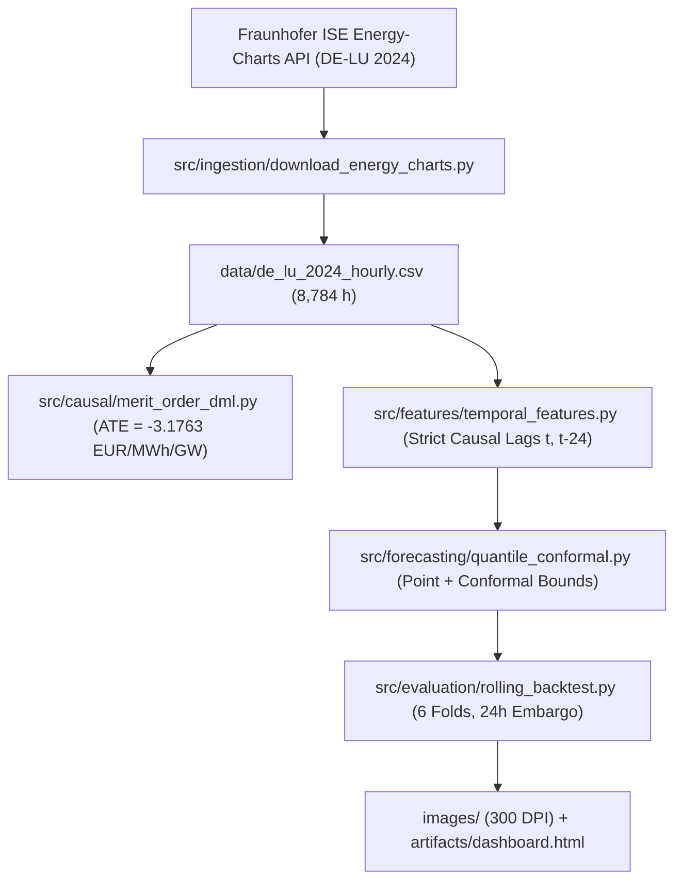
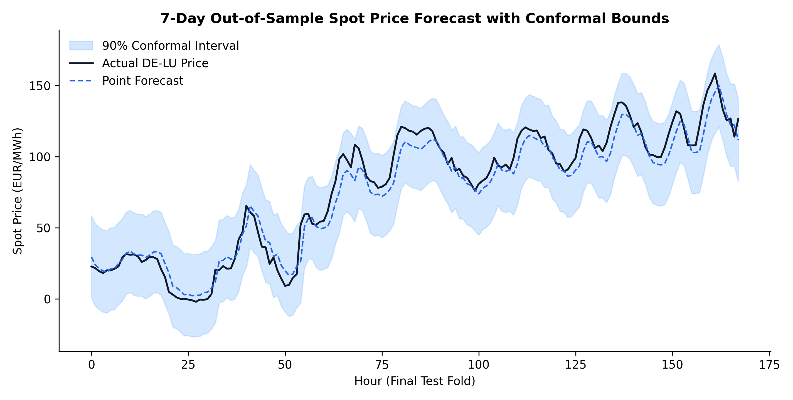

<div align="center">

# ERGF — European Renewable Grid & Price Forecasting
### 8,784-Hour Empirical Telemetry, Causal Merit-Order Econometrics & Conformal Day-Ahead Price Forecasting (DE-LU 2024)

<br/>


-6366F1?style=flat-square)


<br/>

**"From Data to Systems"**  
Monographie quantitative de bout en bout analysant l'intégralité de l'année 2024 du marché électrique germano-luxembourgeois (**DE-LU**, 8 784 heures réelles) pour isoler causalement l'effet *merit-order* des énergies renouvelables et produire des intervalles de prévision conformes calibrés sans fuite temporelle.

</div>

<br/>

<table align="center">
<tr>
<td align="center"><h2>8,784</h2><sub>heures réelles (DE-LU 2024)</sub></td>
<td align="center"><h2>457</h2><sub>heures à prix négatif (5.20%)</sub></td>
<td align="center"><h2>-3.18 €</h2><sub>effet causal / GW renouvelable</sub></td>
<td align="center"><h2>90.88%</h2><sub>couverture PICP (cible 90%)</sub></td>
<td align="center"><h2>17.37%</h2><sub>wMAPE moyen (6 folds)</sub></td>
<td align="center"><h2>7.52 €</h2><sub>Pinball Loss médiane (q50)</sub></td>
</tr>
</table>

---

## Table des Matières

1. [Problématique Énergétique & Enjeux de Marché](#problématique-énergétique--enjeux-de-marché)
2. [Téléchargement, Préparation & Schéma des Données](#téléchargement-préparation--schéma-des-données)
3. [Formulations Mathématiques (DML & Split Conformal)](#formulations-mathématiques-dml--split-conformal)
4. [Architecture du Système](#architecture-du-système)
5. [Résultats Empiriques & Validation Glissante](#résultats-empiriques--validation-glissante)
6. [Preuves Visuelles (300 DPI)](#preuves-visuelles-300-dpi)
7. [Dashboard Interactif & Guide de Reproduction](#dashboard-interactif--guide-de-reproduction)
8. [Structure du Dépôt & Conformité ElmasCore](#structure-du-dépôt--conformité-elmascore)

---

## Problématique Énergétique & Enjeux de Marché

La transition vers un mix électrique dominé par le solaire photovoltaïque et l'éolien introduit deux ruptures majeures sur les marchés *day-ahead* européens :
1. **Compression non-linéaire du *Merit-Order*** : les actifs renouvelables injectent à coût marginal quasi nul. Lors des pics de vent et d'ensoleillement, ils évincement les centrales à gaz/charbon et font basculer le prix marginal en territoire négatif (**457 heures en 2024** sur la zone `DE-LU`, soit 5.20 % de l'année).
2. **Faillite des prévisions ponctuelles** : pour les opérateurs de réseau et les *desks* de négoce, une estimation ponctuelle sans borne de risque calibrée expose à des erreurs de couverture sévères lors des rampes de production.

---

## Téléchargement, Préparation & Schéma des Données

Le pipeline d'ingestion [`src/ingestion/download_energy_charts.py`](./src/ingestion/download_energy_charts.py) automatise la récupération depuis l'API publique **Fraunhofer ISE Energy-Charts** :
1. **Prix *day-ahead*** (`GET /price?bzn=DE-LU&start=2024-01-01&end=2024-12-31`) : série horaire en `EUR/MWh`.
2. **Production & charge nationale** (`GET /public_power?country=de`) : séries 15 minutes (`Load`, `Solar`, `Wind onshore`, `Wind offshore`).
3. **Nettoyage & alignement UTC** :
   - Rééchantillonnage exact à l'heure (`resample("1h").mean()`).
   - Agrégation éolienne (`wind_mw = wind_onshore + wind_offshore`) et écrêtage des valeurs négatives de production (`clip(lower=0.0)`).
   - Jointure interne stricte sur `timestamp_utc` sans valeurs manquantes et export dans [`data/de_lu_2024_hourly.csv`](./data/de_lu_2024_hourly.csv).

| Variable | Unité | Rôle | Description |
|---|---|---|---|
| `hour_index` | `h` | Index | Index horaire monotone `0..8783` |
| `timestamp_utc` | `ISO-8601` | Index | Horodatage UTC aligné |
| `demand_mw` | `MW` | Confondant / Feature | Charge électrique totale du réseau |
| `solar_mw` | `MW` | Traitement / Feature | Production photovoltaïque injectée |
| `wind_mw` | `MW` | Traitement / Feature | Production éolienne totale (onshore + offshore) |
| `spot_price_eur` | `EUR/MWh` | Cible | Prix marginal de règlement *day-ahead* |

---

## Formulations Mathématiques (DML & Split Conformal)

1. **Estimateur Causal *Merit-Order* (Frisch-Waugh-Lovell / Double ML)** :
   $$\tilde{T}_t = T_t - \hat{E}[T_t \mid D_t], \quad \tilde{Y}_t = Y_t - \hat{E}[Y_t \mid D_t], \quad \hat{\theta} = \frac{\sum_t \tilde{T}_t \tilde{Y}_t}{\sum_t \tilde{T}_t^2}$$
   où $T_t = (\text{Solar}_t + \text{Wind}_t)/1000$ (GW), $D_t$ est la demande et $Y_t$ le prix spot.
2. **Calibration Conformale en Échantillon Fini** :
   Sur un jeu de calibration disjoint (20 % finaux de la fenêtre d'entraînement), on calcule le quantile d'ordre $\lceil (n+1)(1-\alpha) \rceil / n$ des résidus absolus $|y_i - \hat{y}_i|$ ($\alpha = 0.10$), garantissant une couverture marginale $\ge 90\%$.

---

## Architecture du Système



---

## Résultats Empiriques & Validation Glissante

- **Effet Causal *Merit-Order*** : **`-3.1763 EUR/MWh/GW`** (`SE = 0.0283`) — chaque GW renouvelable supplémentaire comprime causalement le prix spot de plus de 3 EUR/MWh.
- **Validation *Rolling-Origin* (6 folds, `initial_train = 4320h`, `test = 720h`, `embargo = 24h`)** :
  - **Couverture empirique (`PICP 90%`)** : **`90.88%`** (conforme à la garantie théorique de 90 %).
  - **Erreur relative (`wMAPE`)** : **`17.37%`**.
  - **Perte quantile médiane (`Pinball q50`)** : **`7.5233 EUR/MWh`**.

---

## Preuves Visuelles (300 DPI)

| Figure | Analyse |
|---|---|
|  | **Effet Merit-Order (DE-LU 2024).** Relation inverse entre injection renouvelable (GW) et prix spot (EUR/MWh), colorée par la charge réseau, mettant en évidence les 457 heures de prix négatifs. |
|  | **Prévision Conforme 168h (Fold Final).** Prix observé vs prévision ponctuelle et bande de prédiction conformale à 90 %. |
|  | **Stabilité sur 6 Folds Glissants.** Maintien de la couverture autour de 90 % malgré la saisonnalité et les régimes de volatilité. |

---

## Dashboard Interactif & Guide de Reproduction

- **Dashboard Plotly HTML5 autonome** : [`artifacts/dashboard.html`](./artifacts/dashboard.html)
- **Sortie JSON structurée** : [`artifacts/results.json`](./artifacts/results.json)
- **Notebook de référence** : [`notebooks/01_exploration_and_validation.ipynb`](./notebooks/01_exploration_and_validation.ipynb)

```powershell
.\run.ps1
pytest -v
```

---

## Structure du Dépôt & Conformité ElmasCore

```text
ERGF/
├── data/de_lu_2024_hourly.csv
├── src/
│   ├── ingestion/       # download_energy_charts.py, grid_loader.py
│   ├── features/        # temporal_features.py
│   ├── causal/          # merit_order_dml.py
│   ├── forecasting/     # quantile_conformal.py
│   ├── evaluation/      # rolling_backtest.py
│   └── visualization/   # ergf_plots.py
├── tests/test_ergf_pipeline.py
├── images/              # 3 figures 300 DPI
├── artifacts/           # dashboard.html, results.json
├── ELMAS.md
├── main.py
└── run.ps1
```

Conforme à [`ELMAS.md`](./ELMAS.md) : architecture par domaine métier, fonctions pures déterministes, $\le 3$ niveaux d'indentation, $\le 350$ lignes par module et zéro fuite temporelle vérifiée par `pytest`.
