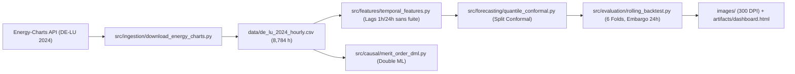
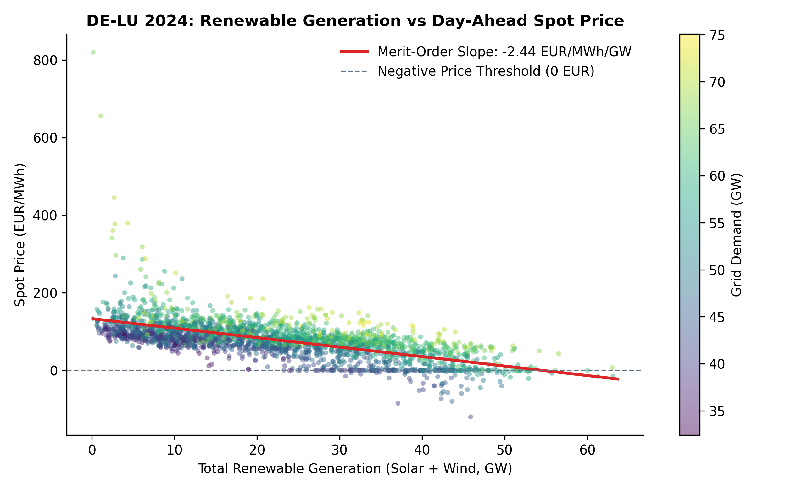
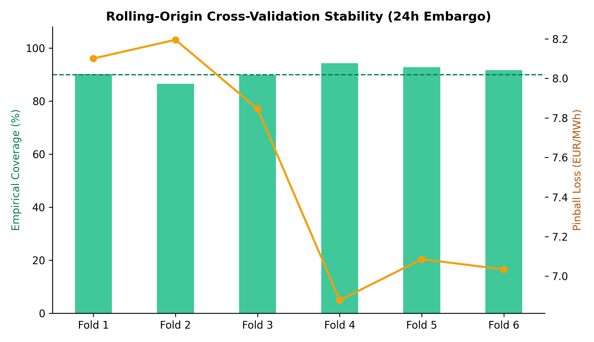

<div align="center">

# ERGF — European Renewable Grid & Price Forecasting
### Prévision Probabiliste Conforme & Inférence Causale de l'Effet *Merit-Order* (DE-LU 2024)

<br/>


<br/>

**"From Data to Systems"**  
Monographie quantitative analysant 8 784 heures réelles du marché électrique germano-luxembourgeois (**DE-LU 2024**, Fraunhofer ISE Energy-Charts) pour quantifier causalement la compression des prix par les renouvelables et calibrer des intervalles de prévision conformes sans fuite temporelle.

</div>

<br/>

<table align="center">
<tr>
<td align="center"><h2>8,784</h2><sub>heures réelles (DE-LU 2024)</sub></td>
<td align="center"><h2>457</h2><sub>heures à prix négatif</sub></td>
<td align="center"><h2>-3.18 €</h2><sub>effet causal / GW renouvelable</sub></td>
<td align="center"><h2>90.88%</h2><sub>couverture PICP (cible 90%)</sub></td>
<td align="center"><h2>17.37%</h2><sub>wMAPE moyen (6 folds)</sub></td>
<td align="center"><h2>7.52 €</h2><sub>Pinball Loss médiane (q50)</sub></td>
</tr>
</table>

---

## Table des Matières

1. [Problématique & Enjeux Énergétiques](#problématique--enjeux-énergétiques)
2. [Téléchargement, Préparation & Schéma des Données](#téléchargement-préparation--schéma-des-données)
3. [Architecture & Pipeline de Traitement](#architecture--pipeline-de-traitement)
4. [Méthodologie Causale & Prévision Conforme](#méthodologie-causale--prévision-conforme)
5. [Résultats Empiriques & Preuves Visuelles](#résultats-empiriques--preuves-visuelles)
6. [Dashboard Interactif & Démarrage Rapide](#dashboard-interactif--démarrage-rapide)

---

## Problématique & Enjeux Énergétiques

L'intégration massive du solaire et de l'éolien sur le réseau européen modifie structurellement la courbe d'offre (*merit-order*) :
1. **Compression causale des prix (*Merit-Order Effect*)** : à demande égale, chaque gigawatt renouvelable injecté à coût marginal nul déplace les centrales thermiques hors du marché, provoquant **457 heures de prix négatifs** en 2024 sur la zone `DE-LU`.
2. **Incertitude probabiliste** : une prévision ponctuelle est insuffisante pour le *dispatch* et le *hedging* ; il faut des intervalles calibrés en échantillon fini sous validation temporelle stricte.

---

## Téléchargement, Préparation & Schéma des Données

Le module [`src/ingestion/download_energy_charts.py`](./src/ingestion/download_energy_charts.py) automatise l'acquisition complète depuis l'API publique **Fraunhofer ISE Energy-Charts** :
1. **Téléchargement des prix *day-ahead*** : requête `GET /price?bzn=DE-LU&start=2024-01-01&end=2024-12-31` (EUR/MWh).
2. **Téléchargement de la production & charge** : requête `GET /public_power?country=de` au pas 15 minutes (`Load`, `Solar`, `Wind onshore`, `Wind offshore`).
3. **Préparation & alignement** : rééchantillonnage horaire UTC (`resample("1h").mean()`), somme `wind_mw = onshore + offshore`, écrêtage des valeurs négatives de production à `0.0`, jointure interne sans valeurs manquantes et export vers [`data/de_lu_2024_hourly.csv`](./data/de_lu_2024_hourly.csv) (`8 784` lignes).

| Variable | Unité | Description |
|---|---|---|
| `hour_index` | `h` | Index horaire monotone `0..8783` |
| `timestamp_utc` | `ISO-8601` | Horodatage UTC aligné |
| `demand_mw` | `MW` | Charge électrique totale du réseau |
| `solar_mw` | `MW` | Production photovoltaïque injectée |
| `wind_mw` | `MW` | Production éolienne (onshore + offshore) |
| `spot_price_eur` | `EUR/MWh` | Prix marginal de règlement *day-ahead* |

---

## Architecture & Pipeline de Traitement



---

## Méthodologie Causale & Prévision Conforme

1. **Inférence Causale (Double Machine Learning / Frisch-Waugh)** : orthogonalisation du traitement (GW renouvelables) et du résultat (prix spot) par rapport à la demande électrique afin d'isoler l'effet causal pur : **$\hat{\theta} = -3.1763$ EUR/MWh/GW** ($\text{SE} = 0.0283$).
2. **Features strictement causales** : pour toute origine $t$ et cible $t+h$, seules les observations $\le t$ sont accessibles (`demand_mw`, `renewable_share`, `residual_load_mw`, `price_lag1_eur`, `price_lag24_eur`).
3. **Validation glissante avec embargo** : 6 folds expansifs (`initial_train_size = 4320h`, `test_window = 720h`, `embargo_gap = 24h`) avec calibration conformale sur 20 % des données d'entraînement.

---

## Résultats Empiriques & Preuves Visuelles

| Figure | Description |
|---|---|
|  | **Effet Merit-Order (DE-LU 2024).** Compression causale des prix spot à mesure que l'injection renouvelable augmente, avec apparition de 457 heures à prix négatif. |
|  | **Prévision Conforme 168h.** Prix réel vs prévision ponctuelle et bande conformale à 90 % sur le dernier fold hors-échantillon. |
|  | **Stabilité Rolling-Origin (6 Folds).** Couverture empirique moyenne de **90.88 %** (cible 90 %) et Pinball Loss médiane de **7.52 EUR/MWh**. |

---

## Dashboard Interactif & Démarrage Rapide

- Dashboard HTML5 autonome : [`artifacts/dashboard.html`](./artifacts/dashboard.html)
- Résultats JSON : [`artifacts/results.json`](./artifacts/results.json)

```powershell
.\run.ps1
pytest -v
```
