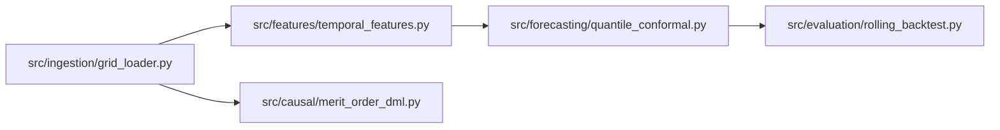

<div align="center">

# ERGF — European Renewable Grid & Price Forecasting
### Prévision Probabiliste Conforme & Inférence Causale de l'Effet *Merit-Order*


</div>

---

## Problématique Scientifique

Dans quelle mesure les chocs de production renouvelable (éolien, solaire) compriment-ils **causalement** les prix spot *day-ahead* européens (*merit-order effect*), et comment produire des intervalles de prévision probabilistes calibrés sans fuite temporelle ?

## Architecture du Domaine (`src/`)



## Résultats & Dataset (`data/eu_grid_hourly.csv`)

| Indicateur | Valeur observée | Description |
|---|---|---|
| Observations | `2 160` heures (90 jours) | Série horaire européenne persistée dans `data/eu_grid_hourly.csv` |
| Backtest glissant | `5` folds (embargo 24h) | Validation temporelle sans fuite |
| Effet *Merit-Order* (DML) | `-2.1910` EUR/MWh/GW (`SE = 0.0150`) | Impact causal marginal de +1 GW renouvelable |
| wMAPE | `0.0767` (7.67 %) | Erreur relative pondérée hors-échantillon |
| PICP (90 %) | `0.9345` (93.45 %) | Couverture empirique des intervalles conformes |
| Pinball Loss (q50) | `3.3947` | Perte quantile médiane (`artifacts/results.json`) |

## Démarrage Rapide

```bash
pytest
python main.py
```

## Dictionnaire des Variables

| Variable | Unité | Description |
|---|---|---|
| `hour_index` | `h` | Index horaire UTC monotone |
| `demand_mw` | `MW` | Charge électrique totale du réseau |
| `solar_mw` | `MW` | Production photovoltaïque injectée |
| `wind_mw` | `MW` | Production éolienne injectée |
| `spot_price_eur` | `EUR/MWh` | Prix marginal de règlement *day-ahead* |
